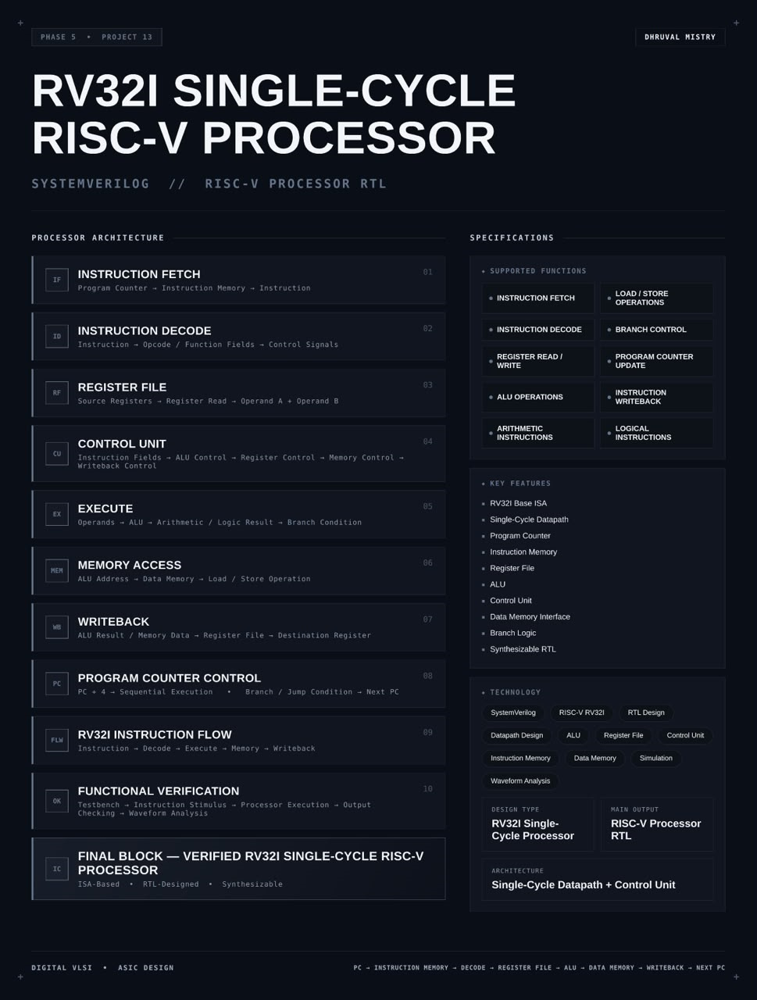
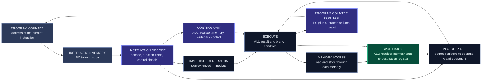
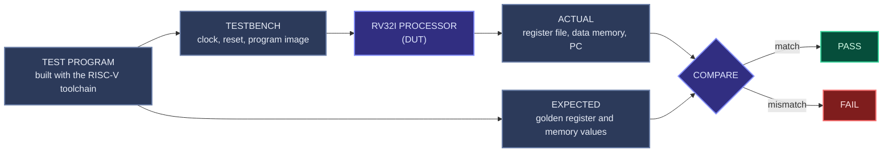

<div align="center">




<b>A synthesizable RV32I RISC-V processor with a single-cycle datapath and control unit, in which every instruction is fetched, decoded, executed, accessed in memory and written back within one clock cycle, written in SystemVerilog.</b>

<br/>


<br/>

[Overview](#overview) |
[At a Glance](#project-at-a-glance) |
[Background](#background-risc-v-and-the-single-cycle-processor) |
[Functions](#supported-functions) |
[Architecture](#architecture) |
[Functional Description](#functional-description) |
[Instruction Set](#instruction-set-and-encoding) |
[Datapath and Control](#datapath-and-control) |
[Interface](#interface) |
[Instruction Flow](#instruction-flow) |
[Getting Started](#getting-started) |
[Verification](#verification) |
[Synthesis](#synthesis) |
[Applications](#applications) |
[FAQ](#faq) |
[License](#license)

</div>

---

## Overview

This project implements an **RV32I single-cycle RISC-V processor** in **SystemVerilog**. RV32I is the base 32-bit integer instruction set of the open RISC-V architecture. The processor reads instructions from memory, decodes them, performs the operation they describe and stores the result, and it does all of this for **one complete instruction in one clock cycle**.

The processor follows the classic flow of a **single-cycle datapath**. The **program counter** holds the address of the current instruction, and the **instruction memory** returns the instruction stored there. **Instruction decode** splits the instruction into its opcode, function fields and register numbers, and the **control unit** turns them into control signals. The **register file** supplies the two source operands, A and B. The **ALU** performs the arithmetic or logic operation, or computes an address, and the **branch logic** evaluates the branch condition. **Memory access** performs loads and stores through the data memory interface. **Writeback** returns the ALU result or the loaded data to the destination register. Finally the **program counter control** selects the next instruction: sequential (`PC + 4`) or a branch or jump target.

The design is **parameterized** where it makes sense, **synthesis-friendly**, verified with a testbench that feeds it instruction streams and checks the processor output, and inspected through waveform analysis. It is packaged as a reusable RISC-V processor core.

<table>
<tr>
<td width="50%" valign="top">

#### Objectives
- Implement the RV32I base integer instruction set in SystemVerilog
- Build a single-cycle datapath with program counter, register file and ALU
- Decode instructions into control signals with a control unit
- Support arithmetic, logical, load, store, branch and jump instructions
- Select the next program counter for sequential and branch or jump flow
- Run real programs compiled with the RISC-V GNU toolchain
- Verify instruction execution by output checking and waveform analysis

</td>
<td width="50%" valign="top">

#### Key Features
- RV32I base ISA
- Single-cycle datapath
- Program counter
- Instruction memory
- Register file
- ALU
- Control unit
- Data memory interface
- Branch logic
- Synthesizable RTL

</td>
</tr>
</table>

---

## Project at a Glance

| Attribute | Detail |
|:--|:--|
| **Design type** | RV32I single-cycle RISC-V processor |
| **Description language** | SystemVerilog (RTL) |
| **Instruction set** | RISC-V RV32I base integer ISA |
| **Datapath width** | 32 bits |
| **Microarchitecture** | Single-cycle: one instruction completes per clock cycle |
| **Register file** | 32 registers, `x0` hardwired to zero |
| **Instruction types** | Arithmetic, logical, load, store, branch, jump, upper-immediate |
| **Memory model** | Instruction memory and data memory interface |
| **Control** | Control unit and ALU control derived from opcode and function fields |
| **Main output** | RISC-V processor RTL |
| **Checking** | Testbench with instruction stimulus, output checking, waveform analysis |
| **Test programs** | Built with the RISC-V GNU toolchain |
| **Functions** | 10 (fetch, decode, register access, ALU, instruction classes, memory, branch, PC update, writeback) |
| **Simulation** | Verilator |
| **Waveform analysis** | GTKWave |
| **Synthesis** | Yosys |
| **License** | MIT |

---

## Background: RISC-V and the Single-Cycle Processor

#### RISC-V and RV32I

**RISC-V** is an open instruction set architecture (ISA). An ISA is the contract between software and hardware: it defines the instructions, the registers and the memory model that a program can rely on. RISC-V is free to implement, modular and small at its core. Its base integer ISA for 32-bit machines is **RV32I**. Extensions such as multiply and divide (M), atomics (A), compressed instructions (C) and floating point (F) are optional additions on top of that base.

RV32I defines:
- **32 integer registers**, `x0` to `x31`, each 32 bits wide. `x0` always reads as zero and ignores writes.
- **A program counter** that holds the address of the current instruction.
- **Fixed-length 32-bit instructions**, always aligned on four-byte addresses.
- **A load and store architecture**: only load and store instructions touch memory, and every other instruction works on registers.
- **Six instruction formats** (R, I, S, B, U and J) that keep the register fields in the same place, so that decoding is simple.

#### What single-cycle means

In a **single-cycle** processor, each instruction takes exactly one clock cycle from start to finish. In that cycle the instruction is fetched, decoded, executed, optionally reads or writes data memory, and writes its result into the register file. The clock period must be long enough for the **slowest** instruction to finish, which is normally a load: it needs instruction memory, register file, ALU, data memory and register write one after another.

| Property | Single-cycle processor |
|:--|:--|
| Cycles per instruction | 1 for every instruction |
| Clock period | Set by the longest instruction path (usually a load) |
| Hardware | Simple: one datapath, one control unit, no pipeline registers |
| Weak point | Fast instructions wait for the clock set by the slow ones |
| Why build it | It shows the complete instruction flow in the clearest form, and it is the basis for pipelined designs |

A single-cycle design is also the natural **reference** for a more advanced one. Its behavior is easy to reason about, so it serves as the golden model against which a pipelined processor can later be compared.

---

## Supported Functions

| Group | Function | Description |
|:--|:--|:--|
| **Fetch** | `INSTRUCTION FETCH` | Reads the instruction at the program counter from instruction memory |
| **Decode** | `INSTRUCTION DECODE` | Splits the instruction into opcode, function fields and register numbers |
| **Registers** | `REGISTER READ / WRITE` | Reads two source registers and writes one destination register |
| **Execute** | `ALU OPERATIONS` | Add, subtract, compare, shift and logic operations, and address calculation |
| **Execute** | `ARITHMETIC INSTRUCTIONS` | ADD, SUB, ADDI and the comparison instructions |
| **Execute** | `LOGICAL INSTRUCTIONS` | AND, OR, XOR, shifts and their immediate forms |
| **Memory** | `LOAD / STORE OPERATIONS` | Reads and writes data memory in byte, half-word and word sizes |
| **Control flow** | `BRANCH CONTROL` | Evaluates branch conditions and selects the branch target |
| **Control flow** | `PROGRAM COUNTER UPDATE` | Chooses between `PC + 4` and a branch or jump target |
| **Writeback** | `INSTRUCTION WRITEBACK` | Writes the ALU result, loaded data or link address into the register file |

---

## Architecture

The processor is organized as the instruction fetch stage (program counter and instruction memory), instruction decode, the register file, the control unit, the execute stage (ALU and branch logic), memory access, writeback and the program counter control. In a single-cycle design these are not clocked stages. They are blocks that the signals flow through within a single clock period.

#### Block diagram

```text
                                           +--------------------+
                                           |   CONTROL UNIT     |
                                           | ALU control        |
                                           | register control   |
                                           | memory control     |
                                           | writeback control  |
                                           +----^----------+----+
                                    opcode,     |          | control signals to all blocks
                                    funct3,     |          v
                                    funct7      |
  +------+    +-------------+  inst  +----------+----+   +----------------+
  |      |    | INSTRUCTION |------->| INSTRUCTION    |   |                |
  |  PC  |--->|   MEMORY    |        | DECODE         |   |  IMMEDIATE     |
  |      |    +-------------+        | rs1, rs2, rd   |   |  GENERATION    |
  +--^---+                           +---+-----+------+   +-------+--------+
     |                                   |     |                  |
     |                            rs1    |     | rs2              | imm
     |                                   v     v                  |
     |                              +---------------+             |
     |                              | REGISTER FILE |             |
     |                              |  x0 = 0       |             |
     |                              +---+-------+---+             |
     |                          operand A|       |operand B        |
     |                                   v       v                 v
     |                              +----------+ +-------------------+
     |            PC -------------->| A MUX    | |      B MUX        |<-- imm
     |                              +----+-----+ +---------+---------+
     |                                   |                 |
     |                                   v                 v
     |                              +---------------------------+     +----------------+
     |                              |            ALU            |---->| BRANCH LOGIC   |
     |                              +-------------+-------------+     | branch taken   |
     |                                            | result            +--------+-------+
     |                                            v                            |
     |                                  +------------------+                   |
     |                                  |  DATA MEMORY     |<-- operand B      |
     |                                  |  INTERFACE       |    (store data)   |
     |                                  |  load / store    |                   |
     |                                  +--------+---------+                   |
     |                                           | load data                   |
     |                                           v                             |
     |                                  +------------------+                   |
     |                                  |  WRITEBACK MUX   |--> rd (register   |
     |                                  | ALU / memory /   |     file write)   |
     |                                  | PC + 4           |                   |
     |                                  +------------------+                   |
     |                                                                         |
     |            +------------------------------------+                       |
     +------------|        PROGRAM COUNTER CONTROL     |<----------------------+
                  |  PC + 4  |  branch target  |  jump  |
                  +------------------------------------+
```

#### Data flow



#### Block breakdown

| # | Block | Role |
|:-:|:--|:--|
| `01` | **Instruction Fetch** | Program counter, instruction memory, instruction |
| `02` | **Instruction Decode** | Instruction to opcode, function fields and control signals |
| `03` | **Register File** | Source registers, register read, operand A and operand B |
| `04` | **Control Unit** | Instruction fields to ALU control, register control, memory control and writeback control |
| `05` | **Execute** | Operands to ALU, arithmetic or logic result, branch condition |
| `06` | **Memory Access** | ALU address to data memory, load or store operation |
| `07` | **Writeback** | ALU result or memory data to register file, destination register |
| `08` | **Program Counter Control** | `PC + 4` for sequential execution, branch or jump condition to next PC |
| `09` | **RV32I Instruction Flow** | Instruction, decode, execute, memory, writeback |
| `10` | **Functional Verification** | Testbench, instruction stimulus, processor execution, output checking, waveform analysis |

> **Final design block:** `PC -> INSTRUCTION MEMORY -> DECODE -> REGISTER FILE -> ALU -> DATA MEMORY -> WRITEBACK -> NEXT PC`

---

## Functional Description

#### Instruction fetch
The program counter (PC) is a 32-bit register that holds the address of the instruction to execute. The instruction memory returns the 32-bit instruction stored at that address. On reset the PC goes to its reset value, and on every clock edge it is loaded with the next PC chosen by the program counter control.

#### Instruction decode
The instruction is split into its fields. The opcode in bits `[6:0]` identifies the instruction class. The function fields `funct3` and `funct7` select the exact operation within a class. The register numbers `rs1`, `rs2` and `rd` sit in fixed positions, so the register file can be read before the instruction is fully decoded. See [Instruction Set and Encoding](#instruction-set-and-encoding).

#### Immediate generation
Many instructions carry an immediate value, and each format stores it in a different set of bits. The immediate generator reassembles the bits for the current format and sign-extends the result to 32 bits.

#### Register file
Thirty-two registers of 32 bits each, with two read ports and one write port. Reading is combinational, so operand A and operand B are available right after decode. Writing happens at the clock edge and only when the control unit allows it. Register `x0` always reads as zero, and a write to `x0` has no effect.

#### Control unit
Looks at the opcode (and the function fields where needed) and produces the control signals for the whole datapath: whether to write a register, which ALU input to use, which ALU operation to perform, whether to read or write data memory, which value to write back, and whether the instruction is a branch or a jump. See [Datapath and Control](#datapath-and-control).

#### Execute
The ALU performs the operation selected by the control unit on operand A and operand B (or the immediate). For arithmetic and logic instructions the ALU output is the result. For loads and stores it is the memory address. For branches the operands are compared by the branch logic, which produces the branch condition.

#### Memory access
For loads, the data memory returns the data at the address computed by the ALU, and the data is extended to 32 bits according to the size and signedness of the load. For stores, the value of the second source register is written to that address in the size of the store. All other instructions leave the data memory untouched.

#### Writeback
A multiplexer picks the value that goes back into the destination register: the ALU result for arithmetic and logic instructions, the loaded data for loads, the return address `PC + 4` for jumps, or the upper-immediate result for `LUI` and `AUIPC`.

#### Program counter control
Selects the next PC. The default is `PC + 4`, which gives sequential execution. A taken branch loads `PC` plus the branch offset. `JAL` loads `PC` plus the jump offset. `JALR` loads the sum of a register and an immediate, with the lowest bit cleared.

#### RV32I instruction flow
Every instruction follows the same path, and the control signals decide which parts of the path do real work: instruction, decode, execute, memory, writeback. See [Instruction Flow](#instruction-flow).

---

## Instruction Set and Encoding

#### Instruction formats

All RV32I instructions are 32 bits wide. The six formats place the same fields in the same bit positions wherever they appear.

| Field | Bits | Present in |
|:--|:-:|:--|
| `opcode` | `[6:0]` | All formats |
| `rd` | `[11:7]` | R, I, U, J |
| `funct3` | `[14:12]` | R, I, S, B |
| `rs1` | `[19:15]` | R, I, S, B |
| `rs2` | `[24:20]` | R, S, B |
| `funct7` | `[31:25]` | R |

```text
 bit    31        25 24    20 19    15 14  12 11         7 6      0
      +------------+--------+--------+------+------------+--------+
 R    |   funct7   |  rs2   |  rs1   |funct3|     rd     | opcode |
      +------------+--------+--------+------+------------+--------+
 I    |      imm[11:0]      |  rs1   |funct3|     rd     | opcode |
      +------------+--------+--------+------+------------+--------+
 S    | imm[11:5]  |  rs2   |  rs1   |funct3| imm[4:0]   | opcode |
      +------------+--------+--------+------+------------+--------+
 B    |imm[12|10:5]|  rs2   |  rs1   |funct3|imm[4:1|11] | opcode |
      +------------+--------+--------+------+------------+--------+
 U    |            imm[31:12]                |     rd     | opcode |
      +--------------------------------------+------------+--------+
 J    |    imm[20|10:1|11|19:12]              |     rd     | opcode |
      +--------------------------------------+------------+--------+
```

| Format | Used for |
|:-:|:--|
| R | Register-register arithmetic and logic |
| I | Immediate arithmetic and logic, loads, `JALR` |
| S | Stores |
| B | Conditional branches |
| U | `LUI` and `AUIPC` |
| J | `JAL` |

#### Immediate generation

The sign bit of every immediate is `inst[31]`, which lets the sign extension start early.

| Format | Immediate (SystemVerilog) |
|:-:|:--|
| I | `{{20{inst[31]}}, inst[31:20]}` |
| S | `{{20{inst[31]}}, inst[31:25], inst[11:7]}` |
| B | `{{19{inst[31]}}, inst[31], inst[7], inst[30:25], inst[11:8], 1'b0}` |
| U | `{inst[31:12], 12'b0}` |
| J | `{{11{inst[31]}}, inst[31], inst[19:12], inst[20], inst[30:21], 1'b0}` |

Branch and jump offsets are always multiples of two, so their lowest bit is a constant zero. The bits of the B and J immediates are scrambled on purpose, so that most bits stay in the same position across formats.

#### Opcodes

| Opcode (binary) | Class | Format |
|:-:|:--|:-:|
| `0110011` | Register-register arithmetic and logic | R |
| `0010011` | Immediate arithmetic and logic | I |
| `0000011` | Loads | I |
| `0100011` | Stores | S |
| `1100011` | Conditional branches | B |
| `1101111` | `JAL` | J |
| `1100111` | `JALR` | I |
| `0110111` | `LUI` | U |
| `0010111` | `AUIPC` | U |
| `0001111` | `FENCE` | I |
| `1110011` | `ECALL`, `EBREAK` | I |

#### RV32I instructions implemented

| Group | Instructions | Operation |
|:--|:--|:--|
| **R-type arithmetic and logic** | `ADD` `SUB` `SLL` `SLT` `SLTU` `XOR` `SRL` `SRA` `OR` `AND` | `rd = rs1 op rs2` |
| **I-type arithmetic and logic** | `ADDI` `SLTI` `SLTIU` `XORI` `ORI` `ANDI` `SLLI` `SRLI` `SRAI` | `rd = rs1 op imm` |
| **Loads** | `LB` `LH` `LW` `LBU` `LHU` | `rd = mem[rs1 + imm]`, extended to 32 bits |
| **Stores** | `SB` `SH` `SW` | `mem[rs1 + imm] = rs2` |
| **Branches** | `BEQ` `BNE` `BLT` `BGE` `BLTU` `BGEU` | If the condition is true, `PC = PC + imm` |
| **Jumps** | `JAL` `JALR` | `rd = PC + 4`, then jump |
| **Upper immediate** | `LUI` `AUIPC` | `rd = imm` or `rd = PC + imm` |
| **System and ordering** | `FENCE` `ECALL` `EBREAK` | Handling `TBD` (see the configuration table) |

That makes 37 computational, memory and control-flow instructions. The three system and ordering instructions have no effect on a simple in-order core with no privileged state, and how this design treats them is listed in the configuration table.

#### Function field encoding

| Operation | `funct3` | `funct7` |
|:--|:-:|:-:|
| `ADD` / `ADDI` | `000` | `0000000` (`ADD`) |
| `SUB` | `000` | `0100000` |
| `SLL` / `SLLI` | `001` | `0000000` |
| `SLT` / `SLTI` | `010` | `0000000` |
| `SLTU` / `SLTIU` | `011` | `0000000` |
| `XOR` / `XORI` | `100` | `0000000` |
| `SRL` / `SRLI` | `101` | `0000000` |
| `SRA` / `SRAI` | `101` | `0100000` |
| `OR` / `ORI` | `110` | `0000000` |
| `AND` / `ANDI` | `111` | `0000000` |

For `ADDI`, `SLTI`, `SLTIU`, `XORI`, `ORI` and `ANDI` there is no `funct7`, because those bits belong to the immediate. For the shift immediates the shift amount is the lower five bits of the immediate, and bit 30 selects arithmetic or logical right shift.

| Class | `funct3` values |
|:--|:--|
| Loads | `LB` = `000`, `LH` = `001`, `LW` = `010`, `LBU` = `100`, `LHU` = `101` |
| Stores | `SB` = `000`, `SH` = `001`, `SW` = `010` |
| Branches | `BEQ` = `000`, `BNE` = `001`, `BLT` = `100`, `BGE` = `101`, `BLTU` = `110`, `BGEU` = `111` |

---

## Datapath and Control

#### Control signals (illustrative)

The control unit produces a set of signals from the opcode. The table shows the typical pattern for each instruction class. The exact signal names, encodings and values are defined in the RTL sources under `rtl/`.

| Class | Register write | ALU operand B | Memory read | Memory write | Writeback source | Branch | Jump |
|:--|:-:|:--|:-:|:-:|:--|:-:|:-:|
| R-type | Yes | Register | No | No | ALU result | No | No |
| I-type arithmetic | Yes | Immediate | No | No | ALU result | No | No |
| Load | Yes | Immediate | Yes | No | Memory data | No | No |
| Store | No | Immediate | No | Yes | Not used | No | No |
| Branch | No | Register | No | No | Not used | Yes | No |
| `JAL` | Yes | Not used | No | No | `PC + 4` | No | Yes |
| `JALR` | Yes | Immediate | No | No | `PC + 4` | No | Yes |
| `LUI` | Yes | Immediate | No | No | Immediate | No | No |
| `AUIPC` | Yes | Immediate | No | No | ALU result (`PC + imm`) | No | No |

#### ALU operations

| ALU operation | Used by |
|:--|:--|
| Add | `ADD`, `ADDI`, address calculation of loads, stores and `JALR`, `AUIPC` |
| Subtract | `SUB`, and the comparison inside branches |
| AND, OR, XOR | `AND`, `OR`, `XOR` and their immediate forms |
| Shift left logical | `SLL`, `SLLI` |
| Shift right logical | `SRL`, `SRLI` |
| Shift right arithmetic | `SRA`, `SRAI` (sign bit is replicated) |
| Set less than, signed | `SLT`, `SLTI` |
| Set less than, unsigned | `SLTU`, `SLTIU` |

Shifts use only the lower five bits of operand B as the shift amount. A two-level control scheme is common: the main control unit gives a coarse ALU class from the opcode, and an ALU control block refines it to the exact operation using `funct3` and `funct7`.

#### Branch logic

The branch logic compares the two source registers and produces a branch-taken signal.

| Instruction | Condition for taking the branch |
|:--|:--|
| `BEQ` | `rs1 == rs2` |
| `BNE` | `rs1 != rs2` |
| `BLT` | `rs1 < rs2`, signed |
| `BGE` | `rs1 >= rs2`, signed |
| `BLTU` | `rs1 < rs2`, unsigned |
| `BGEU` | `rs1 >= rs2`, unsigned |

#### Next program counter

| Case | Next PC |
|:--|:--|
| Normal instruction | `PC + 4` |
| Branch taken | `PC + imm` (B-type immediate) |
| Branch not taken | `PC + 4` |
| `JAL` | `PC + imm` (J-type immediate), with `rd = PC + 4` |
| `JALR` | `(rs1 + imm) & ~1` (lowest bit cleared), with `rd = PC + 4` |

The branch and `JAL` targets are computed relative to the address of the instruction itself. Instruction addresses must be aligned to four bytes, so a target address with a set bit 1 is a misaligned instruction fetch. Whether the design traps, ignores or leaves this undefined is listed in the configuration table.

#### Load and store handling

| Instruction | Memory access | Result written to `rd` |
|:--|:--|:--|
| `LB` | One byte | Byte sign-extended to 32 bits |
| `LBU` | One byte | Byte zero-extended to 32 bits |
| `LH` | Half-word (2 bytes) | Half-word sign-extended |
| `LHU` | Half-word | Half-word zero-extended |
| `LW` | Word (4 bytes) | Full 32-bit word |
| `SB` | One byte written to the byte lane given by `addr[1:0]` | Not applicable |
| `SH` | Half-word written to the half selected by `addr[1]` | Not applicable |
| `SW` | Full word | Not applicable |

The data memory interface carries the address, the write data, a read or write request and byte strobes for sub-word stores. Byte alignment of half-word and word accesses and the behavior on misaligned addresses are listed in the configuration table.

#### Register file rules

| Rule | Behavior |
|:--|:--|
| Read | Combinational, two read ports |
| Write | At the clock edge, when register write is enabled |
| `x0` | Always zero, writes ignored |
| Write and read of the same register in one instruction | The read sees the old value, since the write only completes at the clock edge |

#### Critical path

In a single-cycle processor the clock period is the delay of the longest path through the datapath. The longest instruction is normally a load:

```text
 PC -> instruction memory -> decode and register read -> ALU (address)
    -> data memory -> load extension -> writeback mux -> register file write setup
```

Every instruction pays for this delay, even a simple `ADD` that never touches data memory. The achievable clock frequency and the critical path of this design are listed in the [Synthesis](#synthesis) results as `TBD`, and they are the main reason why pipelined designs exist.

---

## Interface

#### Ports

| Port | Direction | Description |
|:--|:-:|:--|
| Clock | Input | Clock for the program counter, register file and memory writes |
| Reset | Input | Resets the program counter and control state |
| Instruction address | Output | Program counter value sent to the instruction memory |
| Instruction | Input | 32-bit instruction returned by the instruction memory |
| Data address | Output | Address of a load or store |
| Data write data | Output | Value to be stored |
| Data write enable and byte strobes | Output | Store request and byte lanes to write |
| Data read enable | Output | Load request |
| Data read data | Input | Data returned by the data memory |
| Debug outputs | Output | Program counter and register values for observation, if provided |

Exact port names, widths and reset polarity are defined in the RTL sources under `rtl/`.

#### Parameters and configuration

| Item | Value |
|:--|:-:|
| Data width | `TBD` |
| Reset value of the program counter | `TBD` |
| Instruction memory size | `TBD` |
| Data memory size | `TBD` |
| Instruction memory read timing | `TBD` |
| Data memory read timing | `TBD` |
| Memories inside or outside the core | `TBD` |
| Handling of `FENCE`, `ECALL` and `EBREAK` | `TBD` |
| Response to an illegal instruction | `TBD` |
| Behavior on misaligned data access | `TBD` |
| Behavior on misaligned instruction target | `TBD` |
| Debug outputs provided | `TBD` |

---

## Instruction Flow

Every instruction follows the same five steps, and the control signals decide which of them do real work.


| Step | What happens | Instructions that use it |
|:--|:--|:--|
| Instruction | Instruction memory returns the word at the PC | All |
| Decode | Control signals and immediate are produced, registers are read | All |
| Execute | ALU computes a result, an address or a comparison | All except `LUI` and `JAL` (which need little or no ALU work) |
| Memory | Data memory is read or written | Loads and stores only |
| Writeback | A value is written to `rd` | All except stores and branches |

#### Which steps each class uses

| Instruction class | Fetch | Decode | Execute | Memory | Writeback | PC update |
|:--|:-:|:-:|:-:|:-:|:-:|:--|
| R-type, I-type arithmetic | Yes | Yes | Yes | No | Yes | `PC + 4` |
| Load | Yes | Yes | Yes (address) | Read | Yes | `PC + 4` |
| Store | Yes | Yes | Yes (address) | Write | No | `PC + 4` |
| Branch | Yes | Yes | Yes (compare) | No | No | `PC + 4` or target |
| `JAL`, `JALR` | Yes | Yes | Yes (target) | No | Yes (link) | Jump target |
| `LUI`, `AUIPC` | Yes | Yes | Yes | No | Yes | `PC + 4` |

#### Worked example

A small program and what each instruction does. The encodings are the standard RV32I machine code for these instructions.

```text
 address   machine code    instruction              effect
 0x00      0x00500093      addi x1, x0, 5           x1 = 5
 0x04      0x00700113      addi x2, x0, 7           x2 = 7
 0x08      0x002081B3      add  x3, x1, x2          x3 = 12
 0x0C      0x00302023      sw   x3, 0(x0)           data memory[0] = 12
 0x10      0x00002203      lw   x4, 0(x0)           x4 = 12
 0x14      0x00418463      beq  x3, x4, done        taken, because x3 == x4, PC = 0x1C
 0x18      ...             addi x5, x0, 1           skipped
 0x1C      ...             addi x6, x0, 1           x6 = 1   (label done)
 0x20      ...             jal  x0, halt            PC = 0x20, loops here (label halt)
```

The expected final register values are `x1 = 5`, `x2 = 7`, `x3 = 12`, `x4 = 12`, `x5 = 0` and `x6 = 1`. Register `x5` stays zero because the taken branch skips the instruction that would set it.

---

## Repository Structure

```text
rv32i-single-cycle-risc-v-processor/
├── rtl/
│   ├── pc.sv                   # Program counter and next PC select
│   ├── imem.sv                 # Instruction memory, loaded from a hex file
│   ├── regfile.sv              # 32 x 32 register file, x0 hardwired to zero
│   ├── imm_gen.sv              # Immediate generation for all formats
│   ├── control_unit.sv         # Main control and ALU control
│   ├── alu.sv                  # ALU
│   ├── branch_logic.sv         # Branch condition evaluation
│   ├── dmem.sv                 # Data memory (or data memory interface)
│   └── riscv_core.sv           # Top-level processor
├── tb/
│   └── riscv_tb.sv             # Self-checking testbench
├── sw/
│   ├── tests/                  # Assembly test programs
│   ├── prog.S                  # Example program
│   └── prog.hex                # Program image for the instruction memory
├── sim/
│   └── waves.vcd               # Generated waveform dump
├── synth/
│   ├── synth.ys                # Yosys synthesis script
│   ├── riscv_netlist.v         # Gate-level netlist
│   └── synth_report.txt        # Yosys stat report
├── LICENSE
└── README.md
```

---

## Technology Stack

| Tool | Role in this project |
|:--|:--|
|  | RTL design and testbench |
|  | Compiles and simulates the processor |
|  | Views the simulation waveforms |
|  | Synthesizes the RTL to a gate-level netlist |
|  | Builds test programs for the processor |

---

## Getting Started

#### Prerequisites

| Tool | Purpose | Version |
|:--|:--|:--|
| Verilator | RTL simulation | 5.x or later |
| GTKWave | Waveform viewer | Any recent |
| Yosys | RTL synthesis | Any recent |
| RISC-V GNU toolchain | Compiles test programs | Any recent bare-metal build (`riscv64-unknown-elf-*` or `riscv32-unknown-elf-*`) |

```bash
# Ubuntu / Debian
sudo apt update
sudo apt install verilator gtkwave yosys gcc-riscv64-unknown-elf
```

The name of the RISC-V toolchain package differs between distributions. Any bare-metal RISC-V GCC that can target `rv32i` works.

#### 1. Clone

```bash
git clone https://github.com/dhruvalmistry2007/rv32i-single-cycle-risc-v-processor.git
cd rv32i-single-cycle-risc-v-processor
```

#### 2. Build a test program

A tiny program in assembly (`sw/prog.S`):

```asm
    .text
    .globl _start
_start:
    addi x1, x0, 5          # x1 = 5
    addi x2, x0, 7          # x2 = 7
    add  x3, x1, x2         # x3 = 12
    sw   x3, 0(x0)          # data memory[0] = 12
    lw   x4, 0(x0)          # x4 = 12
    beq  x3, x4, done       # taken
    addi x5, x0, 1          # skipped
done:
    addi x6, x0, 1          # x6 = 1
halt:
    jal  x0, halt           # stay here
```

Compile it for RV32I, extract the binary and turn it into a word-per-line hex file:

```bash
riscv64-unknown-elf-gcc -march=rv32i -mabi=ilp32 -nostdlib -nostartfiles \
  -Wl,-Ttext=0x0 -o sw/prog.elf sw/prog.S
riscv64-unknown-elf-objcopy -O binary sw/prog.elf sw/prog.bin
od -An -tx4 -w4 -v sw/prog.bin > sw/prog.hex
```

The `od` command prints one little-endian 32-bit word per line, which is the order in which RISC-V stores instructions. The instruction memory loads this file with `$readmemh`.

#### 3. Simulate

```bash
verilator --binary --timing --trace -Wall --top-module riscv_tb \
  rtl/pc.sv rtl/imem.sv rtl/regfile.sv rtl/imm_gen.sv rtl/control_unit.sv \
  rtl/alu.sv rtl/branch_logic.sv rtl/dmem.sv rtl/riscv_core.sv tb/riscv_tb.sv
./obj_dir/Vriscv_tb +HEX=sw/prog.hex
```

#### 4. View waveforms

```bash
gtkwave sim/waves.vcd
```

#### 5. Synthesize

```bash
yosys -p "read_verilog -sv rtl/pc.sv rtl/imem.sv rtl/regfile.sv rtl/imm_gen.sv rtl/control_unit.sv rtl/alu.sv rtl/branch_logic.sv rtl/dmem.sv rtl/riscv_core.sv; synth -top riscv_core; stat; write_verilog synth/riscv_netlist.v"
```

---

## Verification

The testbench loads a program into the instruction memory, runs the processor until the program reaches its final loop, and then checks the results. The checks compare the **register file** and the **data memory** with the values that the program is expected to produce. Results are also inspected as waveforms.



#### Self-checking approach

| Method | How it works |
|:--|:--|
| Final state check | After the program halts, selected registers and memory words are compared with expected values written into the testbench |
| Signature check | Programs write results to a known memory region, and the region is compared with a stored reference signature (method `TBD`) |
| Golden model comparison | The same program is run on a reference model, such as an instruction-set simulator, and the register trace is compared (reference model `TBD`) |

The expected values for a test program come from the architecture, not from the processor under test, so a wrong implementation cannot make a wrong expectation look right.

#### Test plan

| Area | Scenario | Expected behavior |
|:--|:--|:--|
| Reset | Apply reset | PC returns to its reset value and execution starts there |
| Register `x0` | Write to `x0` and read it back | `x0` always reads as zero |
| Add and subtract | `ADD`, `SUB`, `ADDI` with positive, negative and zero values | Correct 32-bit results, including wraparound |
| Logic | `AND`, `OR`, `XOR` and immediate forms | Correct bitwise results |
| Shifts | `SLL`, `SRL`, `SRA` and immediate forms, including shift amounts 0, 1 and 31 | Correct results, with sign replication for `SRA` |
| Comparisons | `SLT`, `SLTU`, `SLTI`, `SLTIU` with signed and unsigned corner values | Signed and unsigned results differ correctly |
| Upper immediates | `LUI` and `AUIPC` | Correct upper-immediate and PC-relative results |
| Immediate formats | Instructions of every format with positive and negative immediates | Correct sign extension |
| Word loads and stores | `SW`, then `LW` at several addresses | Data stored and returned unchanged |
| Byte and half-word access | `SB`, `SH`, `LB`, `LBU`, `LH`, `LHU` | Correct byte lanes, and correct sign or zero extension |
| Branches taken | Every branch type with its condition true | PC moves to the branch target |
| Branches not taken | Every branch type with its condition false | PC continues at `PC + 4` |
| Branch directions | Forward and backward branches | Both reach the correct target |
| `JAL` | Jump and link | `rd = PC + 4` and PC moves to the target |
| `JALR` | Jump with register base | `rd = PC + 4`, target has bit 0 cleared |
| Loops | A counting loop and a nested loop | Loops run the expected number of times |
| Dependent instructions | Back-to-back instructions that use each other's result | Correct results, since the write completes every cycle |
| Memory edges | Access the first and last data memory address | Data stored and returned correctly |
| Random instruction streams | Random legal instructions compared with the golden model | Register trace always matches |

#### Assertions and checks

| Property | What it checks |
|:--|:--|
| `x0` always zero | The register file never holds a non-zero value in `x0` |
| PC alignment | The program counter is always a multiple of four |
| One memory operation | A load and a store are never active in the same cycle |
| No stray write | The register file changes only when register write is enabled |
| No stray store | Data memory changes only on a store instruction |
| Legal control | Control signals only take legal combinations for the decoded opcode |
| Single cycle | Exactly one instruction completes per clock cycle once the processor is running |

#### Coverage matrix

| Area | Functions checked | Result |
|:--|:--|:-:|
| Fetch and decode | Instruction fetch, instruction decode | `TBD` |
| Registers | Register read and write | `TBD` |
| Execute | ALU operations, arithmetic instructions, logical instructions | `TBD` |
| Memory | Load and store operations | `TBD` |
| Control flow | Branch control, program counter update | `TBD` |
| Writeback | Instruction writeback | `TBD` |
| Instruction coverage | Each RV32I instruction executed at least once | `TBD` |

#### Waveform analysis checklist

| Signal | What to confirm |
|:--|:--|
| Clock and reset | Reset puts the PC at its reset value |
| PC | Steps by four, except at taken branches and jumps |
| Instruction | Matches the program image at each PC |
| Decoded fields and control signals | Match the instruction class |
| Register file read data | Matches the register contents |
| ALU result | Matches the expected operation |
| Data memory address and data | Correct for loads and stores, and quiet for other instructions |
| Register write enable, destination and data | Correct value reaches the destination register |
| Next PC select | Switches to the target only for taken branches and jumps |

---

## Synthesis

The RTL is synthesized with **Yosys** to confirm that the processor is synthesizable. The flow reads the SystemVerilog sources, elaborates the design hierarchy, maps it to generic logic cells, prints a cell statistics report and writes the gate-level netlist. The netlist and the report are stored in [`synth/`](synth/).


| Step | Command | Purpose |
|:--|:--|:--|
| Read | `read_verilog -sv` | Loads the SystemVerilog RTL |
| Synthesize | `synth -top riscv_core` | Elaborates and maps the design to generic gates |
| Report | `stat` | Prints cell and wire statistics |
| Export | `write_verilog` | Writes the gate-level netlist |

#### Results

| Metric | Value |
|:--|:-:|
| Top module | `riscv_core` |
| Total cells | `TBD` |
| Flip-flops | `TBD` |
| Register file bits | `TBD` |
| Memory bits | `TBD` |
| Wires / wire bits | `TBD` |
| Logic depth / critical path | `TBD` |
| Maximum clock frequency | `TBD` |
| Area | `TBD` |

A generic Yosys run builds the register file and any on-chip memories from flip-flops and multiplexers, which makes them large. In a real ASIC flow the memories would be replaced by memory macros, and timing would be measured with static timing analysis against a target library.

---

## Design Considerations

| Aspect | Approach |
|:--|:--|
| **Microarchitecture** | Single-cycle datapath, one instruction per clock cycle |
| **Instruction set** | RV32I base integer ISA, with a fixed 32-bit instruction length |
| **Control** | Control unit decodes the opcode, and ALU control refines the operation from the function fields |
| **Register file** | Two combinational read ports, one synchronous write port, `x0` fixed at zero |
| **Memory** | Separate instruction memory and data memory interface, so a fetch and a data access happen in the same cycle |
| **Immediates** | One immediate generator that handles all five immediate formats |
| **Next PC** | One multiplexer chooses between `PC + 4`, branch target and jump target |
| **Synthesis** | Synthesizable RTL structure, targeting a Yosys flow |
| **Verification** | Self-checking programs, golden values, assertions and waveform inspection |

#### Current limitations
- Single-cycle, so the clock period is set by the slowest instruction and throughput is limited
- Base integer ISA only, with no multiply, divide, compressed or floating-point extensions
- No privileged architecture: no CSRs, interrupts, exceptions or traps
- Memories are simple and have no wait states
- Simulation-based verification only, with no formal verification
- Compliance with the official RISC-V architecture tests has not been run yet

---

## Applications

- Teaching design for processor architecture, from instruction set to datapath
- Reference model and golden model for pipelined RISC-V implementations
- Starting point for adding extensions, a pipeline or a bus interface
- Small control processor core for FPGA and ASIC experiments
- Platform for running small bare-metal programs written in assembly or C
- Basis for a system-on-chip with memory and peripherals around the core

---

## Customization

#### Run a different program

1. Write the program in assembly or in C for bare metal.
2. Compile it with `-march=rv32i -mabi=ilp32` and a text address that matches the reset value of the PC.
3. Convert the binary to a hex file with one 32-bit word per line.
4. Pass the hex file to the testbench with `+HEX=<file>`.
5. Add the expected register and memory values to the testbench, and re-run the simulation.

#### Change the memory sizes

Set the instruction memory and data memory sizes through the parameters, and update the configuration table in this README. Make sure that the program and its data fit, and that the text address used by the linker matches the memory layout.

#### Add an instruction

1. Choose the opcode, `funct3` and `funct7` encoding of the new instruction.
2. Add the decode to the control unit and, if needed, an ALU operation.
3. Add the new case to the instruction tables in this README.
4. Add a directed test and an expected result for it.
5. Re-run the full test set and the synthesis.

---

## Troubleshooting

| Problem | Likely cause | Fix |
|:--|:--|:--|
| `--binary` option not recognized | Verilator version is older than 5.x | Upgrade Verilator to 5.x or later |
| Delays in the testbench are rejected | Timing support is not enabled | Build with `--timing` |
| `waves.vcd` is not generated | Tracing is not enabled | Build with `--trace` and make sure the testbench calls `$dumpfile` and `$dumpvars` |
| Processor runs but executes nothing useful | Hex file not loaded, or wrong path | Check the `+HEX` argument and the `$readmemh` call |
| Wrong instructions executed | Hex file word order or endianness is wrong | Produce the hex with one little-endian word per line |
| PC jumps to a wrong place after a branch | Branch or jump immediate decoded incorrectly | Check the B-type and J-type immediate bit assembly |
| Negative immediates give wrong results | Missing sign extension | Sign-extend from `inst[31]` |
| `SRA` behaves like `SRL` | Arithmetic shift not signed | Use a signed operand for the arithmetic right shift |
| `SLT` and `SLTU` give the same result | Comparison always unsigned or always signed | Use signed comparison for `SLT` and unsigned for `SLTU` |
| `x0` shows a non-zero value | Register file write to `x0` not blocked | Ignore writes to register 0 |
| Loaded byte has the wrong sign | Load extension mixes signed and unsigned | Check the `LB`, `LBU`, `LH` and `LHU` extension |
| Store changes the wrong bytes | Byte strobes do not follow `addr[1:0]` | Check the byte lane logic for `SB` and `SH` |
| Test program does not link at address 0 | Text address is not set | Pass `-Wl,-Ttext=0x0` to the compiler |
| Yosys cannot find the top module | `-top` name does not match the module name | Use the exact module name from `rtl/riscv_core.sv` |

---

## FAQ

**What does single-cycle mean?**
Each instruction takes exactly one clock cycle. All five steps of the instruction (fetch, decode, execute, memory and writeback) happen in that one cycle, one after another through the datapath, with no registers between them.

**Why is a single-cycle processor slow?**
The clock must be slow enough for the longest instruction, usually a load, to finish. Shorter instructions then waste the rest of the cycle. A pipelined processor fixes this by overlapping the steps of different instructions.

**Why does `x0` always read as zero?**
RISC-V reserves register zero as a constant. Having a free zero simplifies the instruction set: a move is an add with `x0`, a comparison against zero needs no immediate, and a discarded result can be written to `x0`.

**Why are the immediate bits scrambled in branch and jump instructions?**
The format keeps the source and destination register fields and the sign bit in the same place in every format. The immediate bits are placed around them, which saves multiplexers in the decoder, and it makes the immediate generation a simple wiring step.

**Why does `JALR` clear the lowest bit?**
Instruction addresses are two-byte aligned at minimum, so the lowest bit of a jump target is never meaningful. Clearing it lets hardware ignore that bit.

**How do loads of bytes and half-words work?**
The data memory returns a full word, and the processor selects the right byte or half-word and extends it. Signed loads copy the top bit into the upper bits, and unsigned loads fill them with zero.

**How is the processor tested without a reference core?**
A test program is written so that the correct final register and memory values can be worked out from the architecture. The testbench compares the processor against these expected values, and a reference model can be added for larger tests.

**Why Verilator, GTKWave and Yosys?**
They are free, open-source tools that cover simulation, waveform viewing and synthesis, so the whole project can be reproduced without licenses.

---

## Learning Outcomes

- Understanding the RV32I instruction set and its six instruction formats
- Designing a single-cycle datapath with a program counter, register file and ALU
- Writing a control unit and an ALU control that decode instructions into control signals
- Generating immediates and handling sign extension for every format
- Implementing load and store operations with byte, half-word and word access
- Implementing branches, jumps and next PC selection
- Building and running test programs with the RISC-V GNU toolchain
- Verifying a processor with self-checking programs and waveform analysis
- Understanding the critical path of a single-cycle design and why pipelining is used

---

## Design Flow


<div align="center">

`PC` | `INSTRUCTION MEMORY` | `DECODE` | `REGISTER FILE` | `ALU` | `DATA MEMORY` | `WRITEBACK` | `NEXT PC`

</div>

---

## Future Work

- Run the official RISC-V architecture compliance tests (riscv-arch-test) and fix any differences
- Add a compare against an instruction-set simulator for random instruction streams
- Add the `FENCE`, `ECALL` and `EBREAK` behavior and an illegal instruction response
- Add CSR instructions and a basic machine-mode privileged architecture
- Add the M extension for multiply and divide
- Add a bus interface so that the core can sit in a system-on-chip
- Move to a pipelined version of the same core and compare it with this one
- Add formal properties for the register file and the instruction decode
- Run the design through an RTL-to-GDSII flow (OpenLane)

---

## Contributing

Suggestions and improvements are welcome. Open an issue to discuss a change, or submit a pull request with a clear description of what it does and the simulation results that support it.

---

## References

- [Verilator](https://www.veripool.org/verilator/): open-source SystemVerilog simulator
- [GTKWave](https://gtkwave.sourceforge.net/): waveform viewer
- [Yosys Open SYnthesis Suite](https://yosyshq.net/yosys/): open-source RTL synthesis framework
- [RISC-V International](https://riscv.org/technical/specifications/): RISC-V instruction set specifications
- [RISC-V GNU toolchain](https://github.com/riscv-collab/riscv-gnu-toolchain): compiler and tools for RISC-V
- IEEE Std 1800: SystemVerilog language standard
- The RISC-V Instruction Set Manual, Volume I: Unprivileged ISA

---

## License

This project is licensed under the **MIT License**. See the [LICENSE](LICENSE) file for details.

---

## Author

<div align="center">

**Dhruval Mistry**

[](https://github.com/dhruvalmistry2007)

<br/>


</div>
